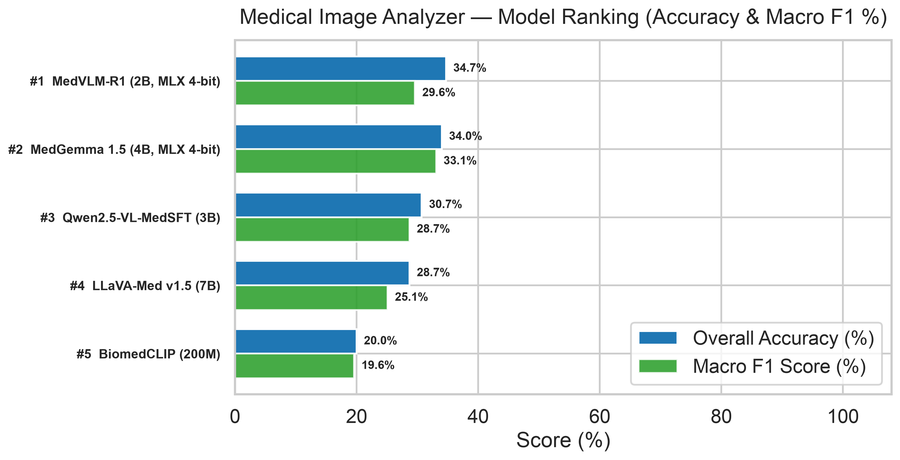
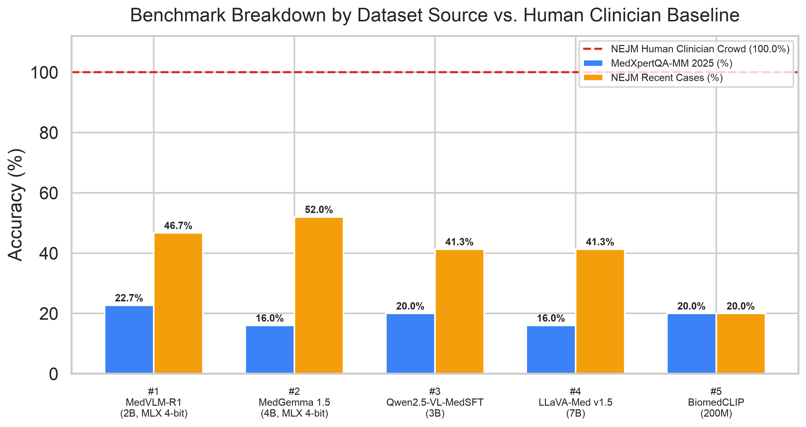
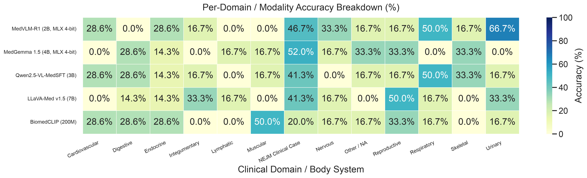
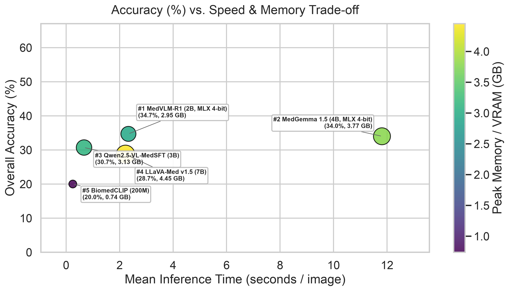

# Medical Image Analysis: Multi-Model VLM Comparison

[](https://colab.research.google.com/github/JapjeetSingh17/Medical-Image-Analysis-Multi-Model-Comparison/blob/main/notebooks/medical_vlm_benchmark_colab.ipynb)

An **AI in Healthcare** course mini-project that benchmarks **5 medical-image-trained Vision-Language Models (VLMs)** on an **uncontaminated 150-image multi-modality clinical dataset**, ranks them by accuracy and Macro F1 (%), compares them against a **Human Clinician Crowd baseline**, generates percentage-based visualizations, and provides a **3-case Gradio Live Presentation Demo**.

Supports both **Apple Silicon MLX (`M1/M2/M3`, 8 GB RAM)** locally and **Google Colab (T4 GPU)** in the cloud.

---

## Final Benchmark Leaderboard (150 Uncontaminated Clinical Cases)

Evaluated across **75 `TsinghuaC3I/MedXpertQA` (`MM`, 2025)** cases and **75 recent `OctoMed/NEJM-Image-Challenge`** cases (hybrid run: 4-bit MLX on Apple M1 8 GB RAM + 4-bit NF4 on Google Colab T4):

| Rank | Model | Overall Acc (%) | Macro F1 (%) | MedXpertQA (%) | NEJM (%) | Format OK (%) | Latency (s/img) | Peak Memory |
| :---: | :--- | :---: | :---: | :---: | :---: | :---: | :---: | :---: |
| **#1** | **MedVLM-R1 (2B, MLX 4-bit)** | **34.7%** | 29.6% | **22.7%** | 46.7% | **100.0%** | 2.33s | 2.95 GB |
| **#2** | **MedGemma 1.5 (4B, MLX 4-bit)** | **34.0%** | **33.1%** | 16.0% | **52.0%** | 94.7% | 11.81s | 3.77 GB |
| **#3** | **Qwen2.5-VL-MedSFT (3B)** | **30.7%** | 28.7% | 20.0% | 41.3% | **100.0%** | **0.67s** | 3.13 GB |
| **#4** | **LLaVA-Med v1.5 (7B)** | **28.7%** | 25.1% | 16.0% | 41.3% | 16.7% | 2.22s | 4.45 GB |
| **#5** | **BiomedCLIP (200M)** | **20.0%** | 19.6% | 20.0% | 20.0% | **100.0%** | **0.25s** | **0.74 GB** |

- **NEJM Human Clinician Plurality Accuracy (Top Crowd Vote):** `100.0%` (`51.8%` mean correct vote share)

### Visual Results





---

## Why This Benchmark Design?

1. **Avoids Dataset Leakage:** Instead of classic over-trained datasets (`MedMNIST`, `VQA-RAD`, `HAM10000`), we curate **150 clinical cases** from:
   - **75 single-image cases from [`TsinghuaC3I/MedXpertQA`](https://huggingface.co/datasets/TsinghuaC3I/MedXpertQA) (`MM`, 2025)** — stratified across body systems (Cardiovascular, Skeletal, Nervous, Respiratory, etc.).
   - **75 recent cases from [`OctoMed/NEJM-Image-Challenge`](https://huggingface.co/datasets/OctoMed/NEJM-Image-Challenge)** — real *New England Journal of Medicine* clinical cases with **physician crowd voting stats**.
2. **Runs Comfortably on 8 GB M1 Mac (MLX) or Colab T4:** Models load sequentially in 4-bit quantization (`<= 4.45 GB` peak memory) with per-image `.jsonl` checkpoints and explicit cache clearing (`mx.clear_cache()` / `torch.cuda.empty_cache()`).
3. **Presentation-Ready:** Includes an interactive **Gradio Live Demo** (`src/demo_app.py`) preloaded with 3 multi-modality cases + custom image upload, plus 3 static backup demo cards (`results/demos/demo_case_1..3.png`).

---

## Project Structure

```text
.
├── .agents/plugins/colab/                # Antigravity colab-mcp customization plugin
├── notebooks/
│   └── medical_vlm_benchmark_colab.ipynb # Step-by-step Google Colab T4 notebook
├── results/
│   ├── charts/                           # 4 percentage ranking PNG graphs
│   ├── demos/                            # 3 static presentation demo PNG cards
│   ├── report.md                         # Generated Markdown leaderboard
│   └── summary.csv                       # Full metrics CSV
├── src/
│   ├── prepare_dataset.py                # Builds 150-image MedXpertQA + NEJM manifest
│   ├── models.py                         # Apple MLX, CUDA 4-bit & BiomedCLIP adapters
│   ├── parser.py                         # Extracts <think>, <answer>, and option letters
│   ├── evaluate.py                       # Ranks models & exports summary.csv / report.md
│   ├── plot_results.py                   # Generates 4 percentage comparison PNG charts
│   └── demo_app.py                       # Gradio 3-case live demo + static backup cards
├── tests/
│   └── test_parser_and_metrics.py        # Local pytest suite (7 tests)
├── run_benchmark.py                      # Unified CLI (auto-detects Apple Silicon MLX vs CUDA)
├── requirements-colab.txt                # Colab / PyTorch dependencies
└── TEAM_EXPLANATION.md                   # 2-part member breakdown for professor evaluation
```

---

## Quick Start

### Option A: Local Apple Silicon Mac (M1/M2/M3, 8 GB+ RAM via MLX)
```bash
uv venv --python 3.12
uv pip install --python .venv/bin/python mlx mlx-vlm open_clip_torch datasets huggingface-hub pillow pandas scikit-learn matplotlib seaborn tqdm gradio pytest
.venv/bin/python -m src.prepare_dataset --output-dir data/benchmark_150
.venv/bin/python run_benchmark.py --data-dir data/benchmark_150 --results-dir results --full
```
Launch the interactive 3-case live presentation demo locally:
```bash
.venv/bin/python -m src.demo_app --manifest data/benchmark_150/manifest.csv --launch-gradio
```

### Option B: Google Colab (T4 GPU)
Click the **Open in Colab** badge at the top, select **Runtime → Change runtime type → T4 GPU**, and run the cells.

---

## Local Testing

```bash
.venv/bin/pytest -v
```

> **Clinical Disclaimer:** This project is strictly for academic and educational benchmarking in healthcare AI. Model predictions must not be used for real medical diagnosis or clinical decision-making.
